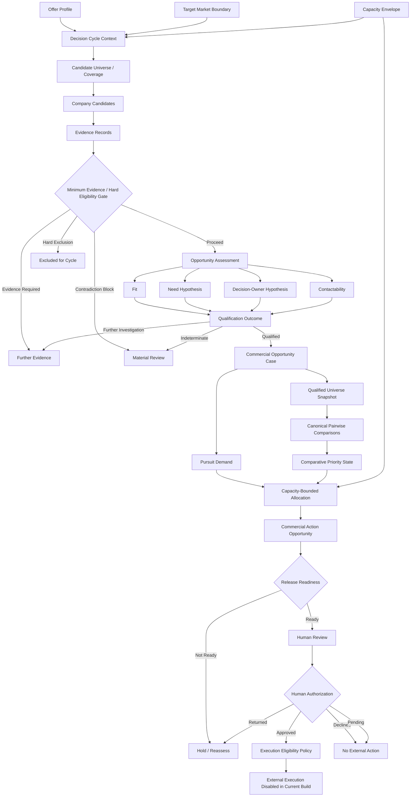
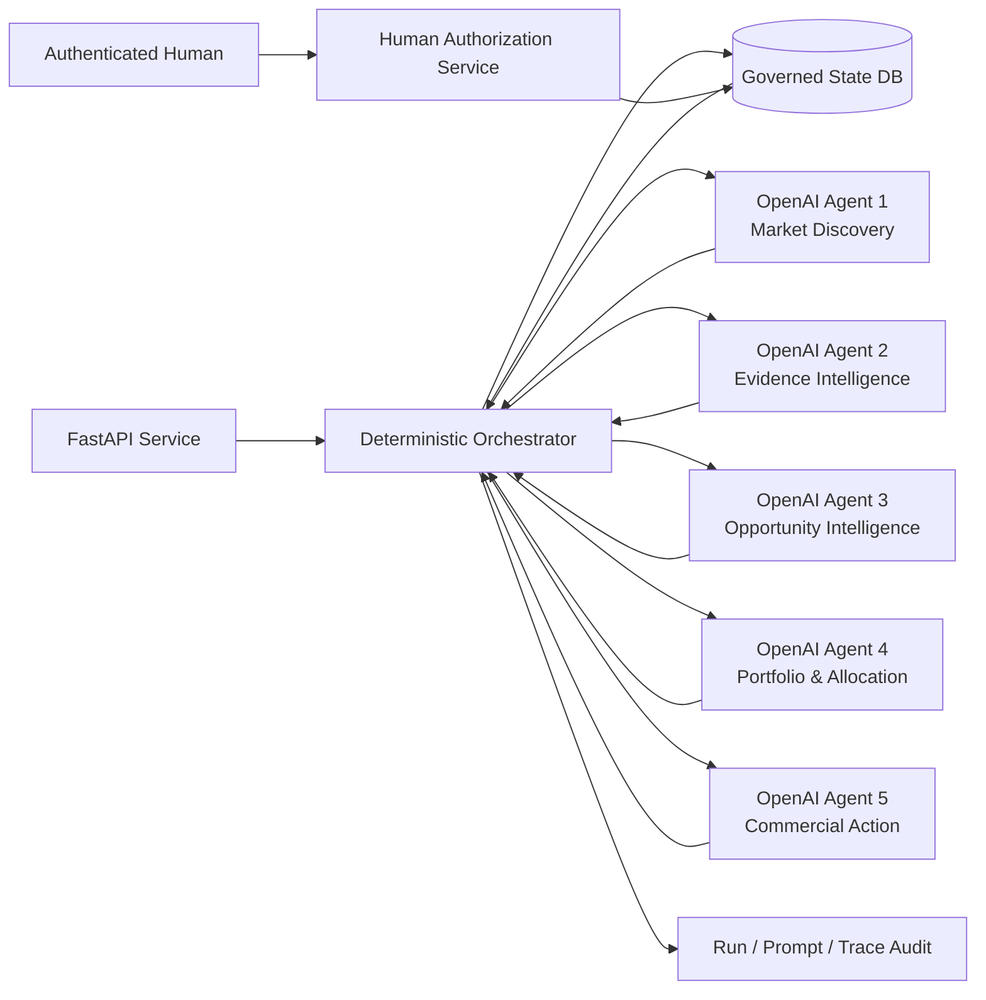
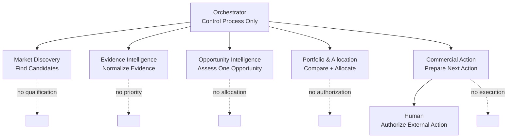
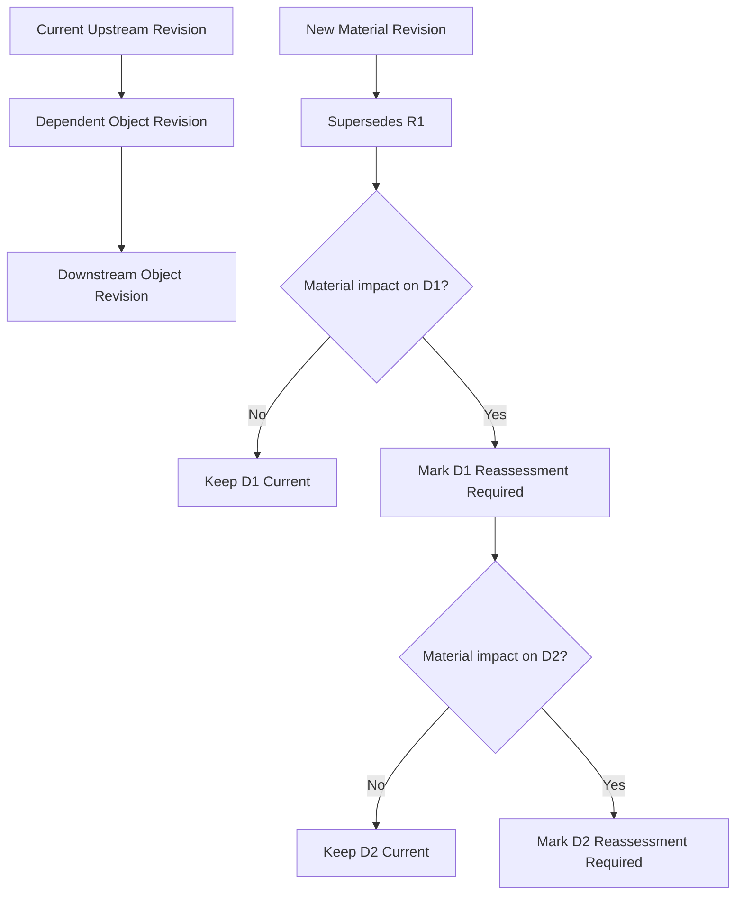
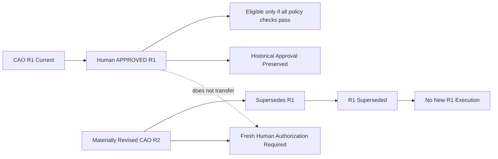

# 12 — System and Decision Flow Diagrams

## 1. Business decision flow

## 2. Technical runtime flow

## 3. Responsibility boundary

## 4. Revision and reassessment flow

## 5. Authorization revision isolation

